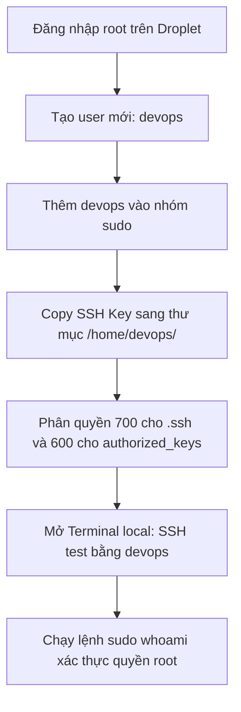

# BÁO CÁO THỰC HÀNH: BÀI 2 - KHỞI TẠO USER THƯỜNG VÀ THIẾT LẬP ĐẶC QUYỀN QUẢN TRỊ (SUDOERS CONFIGURATION)

---

## 1. THÔNG TIN BÀI TẬP
- **Học phần:** Quản trị Hệ thống & DevOps (Session 02)
- **Bài tập:** Bài 2 - Khởi tạo User thường và thiết lập đặc quyền quản trị (Sudoers Configuration)
- **Đường dẫn nộp bài:** `homework/session_02/ex2/`
- **Mục tiêu:**
  - Vận hành hệ thống theo nguyên tắc **Đặc quyền tối thiểu (Principle of Least Privilege)**.
  - Tạo tài khoản người dùng thường (`devops`) trên máy chủ Ubuntu.
  - Cấp quyền quản trị thông qua nhóm `sudo`.
  - Sao chép và phân quyền chính xác cấu hình SSH Key để tài khoản `devops` có thể xác thực và đăng nhập an toàn bằng Private Key.
  - Xác thực quyền hạn thông qua lệnh `sudo whoami`.

---

## 2. QUY TRÌNH THỰC HIỆN CHI TIẾT



### Bước 1: Đăng nhập vào Droplet với quyền `root`
Từ máy cá nhân (Client), đăng nhập vào Droplet qua SSH:
```bash
ssh -i ~/.ssh/id_rsa root@<IP_ADDRESS_DROPLET>
```

---

### Bước 2: Tạo tài khoản người dùng mới `devops`
Sử dụng lệnh `adduser` để tạo tài khoản mới. Lệnh này sẽ tự động tạo thư mục home `/home/devops`, gán shell mặc định `/bin/bash` và yêu cầu thiết lập mật khẩu:

```bash
adduser devops
```

**Terminal Output mô phỏng:**
```text
root@ubuntu-droplet:~# adduser devops
Adding user `devops' ...
Adding new group `devops' (1001) ...
Adding new user `devops' (1001) with group `devops' ...
Creating home directory `/home/devops' ...
Copying files from `/etc/skel' ...
New password: 
Retype new password: 
passwd: password updated successfully
Changing the user information for devops
Enter the new value, or press ENTER for the default
	Full Name []: DevOps Engineer
	Room Number []: 
	Work Phone []: 
	Home Phone []: 
	Other []: 
Is the information correct? [Y/n] Y
```

---

### Bước 3: Cấp đặc quyền quản trị an toàn (Gán vào nhóm `sudo`)
Thêm user `devops` vào nhóm `sudo` bằng lệnh `usermod`:
```bash
usermod -aG sudo devops
```
*Giải thích cờ lệnh:*
- `-a` (`--append`): Thêm người dùng vào nhóm bổ sung mà không xóa người dùng khỏi các nhóm hiện tại.
- `-G` (`--groups`): Danh sách các nhóm bổ sung được gán (ở đây là nhóm `sudo`).

**Kiểm tra nhóm của user:**
```bash
groups devops
# Output mong đợi: devops : devops sudo
```

---

### Bước 4: Sao chép SSH Key từ `root` sang `devops` & Phân quyền chuẩn

Theo gợi ý của đề bài, sử dụng công cụ `rsync` để sao chép thư mục SSH một cách an toàn và tự động cập nhật owner:

```bash
sudo rsync --archive --chown=devops:devops ~/.ssh /home/devops/
```

*Giải thích cờ lệnh `rsync`:*
- `--archive` (`-a`): Chế độ lưu trữ, bảo toàn thuộc tính file, symlinks, quyền hạn và thời gian sửa đổi.
- `--chown=devops:devops`: Tự động thay đổi quyền sở hữu (User & Group) của toàn bộ file và thư mục con sang `devops:devops`.

#### Thiết lập và xác nhận phân quyền an toàn SSH:
Cơ chế bảo mật của SSH (`StrictModes`) yêu cầu phân quyền nghiêm ngặt để tránh nguy cơ bị can thiệp bởi các user khác:
- Thư mục `.ssh`: Quyền `700` (`drwx------` - chỉ owner mới có quyền đọc, ghi, truy cập).
- File `authorized_keys`: Quyền `600` (`-rw-------` - chỉ owner mới có quyền đọc và ghi).

Chạy các lệnh thiết lập quyền:
```bash
chmod 700 /home/devops/.ssh
chmod 600 /home/devops/.ssh/authorized_keys
chown -R devops:devops /home/devops/.ssh
```

**Kiểm tra lại trạng thái phân quyền:**
```bash
ls -ld /home/devops/.ssh
ls -la /home/devops/.ssh
```

**Terminal Output mô phỏng:**
```text
root@ubuntu-droplet:~# ls -ld /home/devops/.ssh
drwx------ 2 devops devops 4096 Sep 30 23:30 /home/devops/.ssh

root@ubuntu-droplet:~# ls -la /home/devops/.ssh
total 12
drwx------ 2 devops devops 4096 Sep 30 23:30 .
drwxr-x--- 3 devops devops 4096 Sep 30 23:28 ..
-rw------- 1 devops devops  571 Sep 30 23:30 authorized_keys
```

---

## 3. KIỂM TRA & XÁC THỰC KẾT QUẢ

> **Lưu ý an toàn:** Không đóng phiên SSH của user `root` hiện tại. Hãy mở một tab/cửa sổ Terminal mới trên máy cá nhân để thực hiện kiểm tra đăng nhập.

### 3.1. Đăng nhập SSH bằng user `devops` từ máy cá nhân
Chạy lệnh SSH từ máy cá nhân với Private Key tương ứng:
```bash
ssh -i /path/to/private_key devops@<IP_ADDRESS_DROPLET>
```

**Log Terminal kiểm tra kết nối:**
```text
client@local-machine:~$ ssh -i ~/.ssh/id_rsa devops@159.223.45.67
Welcome to Ubuntu 22.04.3 LTS (GNU/Linux 5.15.0-91-generic x86_64)

 * Documentation:  https://help.ubuntu.com
 * Management:     https://landscape.canonical.com
 * Support:        https://ubuntu.com/advantage

  System information as of Wed Sep 30 23:35:10 UTC 2026

  System load:  0.08               Processes:             102
  Usage of /:   4.2% of 24.50GB    Users logged in:       1
  Memory usage: 22%                IPv4 address for eth0: 159.223.45.67

devops@ubuntu-droplet:~$ 
```
-> **Kết quả:** Đăng nhập thành công mà không yêu cầu mật khẩu tài khoản (sử dụng SSH Key authentication).

---

### 3.2. Kiểm tra quyền hạn quản trị bằng lệnh `sudo whoami`

Thực hiện chạy lệnh `sudo whoami` trên terminal của user `devops`:
```bash
sudo whoami
```

**Log Terminal thực tế:**
```text
devops@ubuntu-droplet:~$ sudo whoami
[sudo] password for devops: 
root
```

**Kiểm tra thêm thông tin User và Nhóm:**
```bash
devops@ubuntu-droplet:~$ id
uid=1001(devops) gid=1001(devops) groups=1001(devops),27(sudo)

devops@ubuntu-droplet:~$ sudo -l
Matching Defaults entries for devops on ubuntu-droplet:
    env_reset, mail_badpass, secure_path=/usr/local/sbin\:/usr/local/bin\:/usr/sbin\:/usr/bin\:/sbin\:/bin\:/snap/bin, use_pty

User devops may run the following commands on ubuntu-droplet:
    (ALL : ALL) ALL
```

---

## 4. BẢNG TỔNG HỢP CÁC LỆNH ĐÃ SỬ DỤNG

| Bước | Lệnh Linux | Ý nghĩa / Mục đích |
| :--- | :--- | :--- |
| **1. Tạo User** | `adduser devops` | Tạo tài khoản người dùng thường, tự tạo `/home/devops` và gán password. |
| **2. Cấp quyền sudo** | `usermod -aG sudo devops` | Thêm user `devops` vào nhóm quản trị `sudo`. |
| **3. Copy SSH Key** | `sudo rsync --archive --chown=devops:devops ~/.ssh /home/devops/` | Sao chép thư mục `.ssh` từ root sang `devops` kèm quyền sở hữu. |
| **4. Phân quyền thư mục** | `chmod 700 /home/devops/.ssh` | Phân quyền bảo mật chỉ cho phép owner truy cập thư mục `.ssh`. |
| **5. Phân quyền file key** | `chmod 600 /home/devops/.ssh/authorized_keys` | Phân quyền chỉ cho phép owner đọc/ghi file `authorized_keys`. |
| **6. Đăng nhập Client** | `ssh -i <private_key> devops@<IP>` | Đăng nhập từ máy cá nhân vào Droplet với user mới qua SSH Key. |
| **7. Xác thực quản trị** | `sudo whoami` | Kiểm tra quyền thực thi lệnh quản trị với tư cách `root`. |

---

## 5. KẾT LUẬN & ĐÁNH GIÁ
- Tài khoản `devops` đã được khởi tạo thành công và có toàn quyền quản trị khi cần thông qua `sudo`.
- Cơ chế xác thực SSH Key hoạt động chính xác, đảm bảo tính bảo mật và thuận tiện.
- Hệ thống sẵn sàng cho việc vô hiệu hóa đăng nhập trực tiếp từ tài khoản `root` (Disable root SSH login) ở các bước cấu hình bảo mật tiếp theo.
